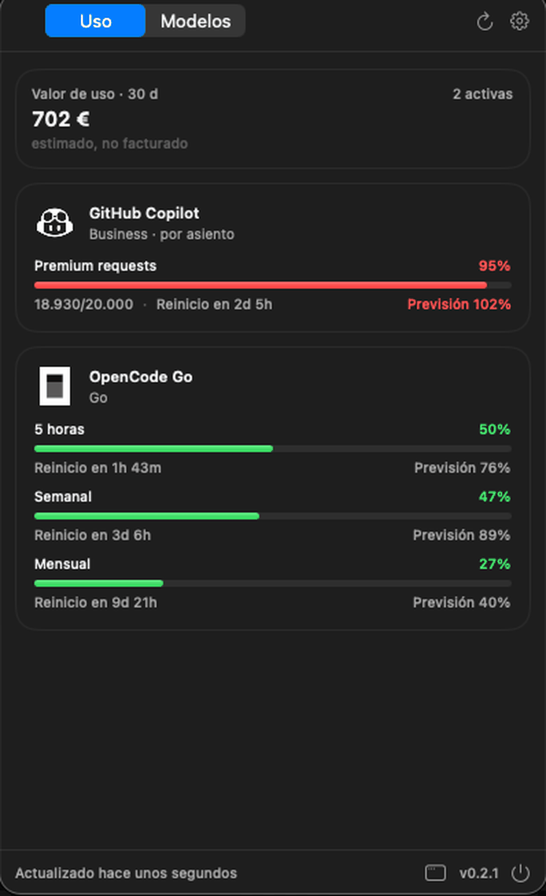
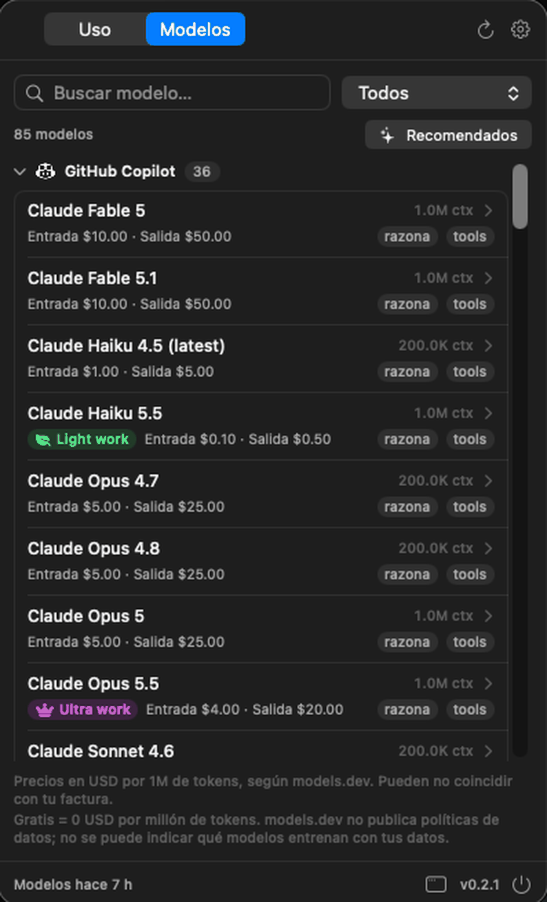

<p align="center">
  
</p>

<h1 align="center">Usage Tracker</h1>

<p align="center">
  El uso, las cuotas y el coste de <b>OpenCode Go</b>, <b>GitHub Copilot</b> y <b>Claude</b><br/>
  juntos en la barra de menús de macOS.
</p>

<p align="center">
  <a href="https://github.com/KemelMoh/usage-tracker/releases/latest"></a>
  
  
  
  
</p>

<p align="center">
  
  &nbsp;&nbsp;
  
</p>

<p align="center">
  Sin backend, sin telemetría y sin sincronización en la nube: todo se queda en tu Mac.
</p>

---

## Contenido

- [Instalar](#-instalar)
- [Qué hace](#-qué-hace)
- [Cómo funciona](#-cómo-funciona)
- [Datos y credenciales](#-datos-y-credenciales)
- [Desarrollo](#-desarrollo)
- [Solución de problemas](#-solución-de-problemas)
- [Licencia](#-licencia)

## 📦 Instalar

### Homebrew

```bash
brew tap KemelMoh/usage-tracker
brew trust --cask KemelMoh/usage-tracker/usage-tracker
brew install --cask usage-tracker
```

`brew trust` es necesario en Homebrew 7 para taps de terceros. La release actual del cask es **arm64**.

Para actualizar:

```bash
brew update
brew upgrade --cask usage-tracker
```

El tap está en [KemelMoh/homebrew-usage-tracker](https://github.com/KemelMoh/homebrew-usage-tracker).

<details>
<summary>Prefiero el DMG</summary>

El workflow de release genera `UsageTracker-x.y.z.dmg` y lo adjunta a la release de GitHub:

1. Descarga el DMG de la [última release](https://github.com/KemelMoh/usage-tracker/releases/latest).
2. Ábrelo y arrastra **Usage Tracker** a **Aplicaciones**.
3. La app está firmada en modo ad-hoc, así que macOS puede mostrar el aviso de desarrollador no identificado. En ese caso:
   - clic derecho en la app → **Abrir** → **Abrir**, o
   - ejecuta:
     ```bash
     xattr -dr com.apple.quarantine "/Applications/Usage Tracker.app"
     ```

El DMG no se guarda en el repositorio; se publica como asset de la release.

</details>

<details>
<summary>Quiero compilarla yo</summary>

```bash
git clone https://github.com/KemelMoh/usage-tracker.git
cd usage-tracker
./build.sh --open
```

El script compila en release, crea `Usage Tracker.app` en la raíz del proyecto, la firma en modo ad-hoc y la abre. También puedes usar `./build.sh debug` o compilar solo con `swift build`.

Para tenerla siempre a mano, arrastra `Usage Tracker.app` a `/Applications`. El arranque automático al iniciar sesión necesita que la app esté en `/Applications` (macOS lo exige para `SMAppService`).

</details>

**Requisitos:** macOS 13 (Ventura) o superior. No usa dependencias de terceros.

## ✨ Qué hace

| | |
|---|---|
| **Panel compacto** | Al hacer clic en el icono se abre el panel, con pestañas **Uso** y **Modelos**, refresco y engranaje de ajustes. |
| **Cuota actual** | Ventanas de uso de cada proveedor (5 h, semanal, mensual…), porcentaje consumido, cuenta atrás hasta el reinicio y previsión de consumo al final de la ventana. |
| **Valor de uso** | Coste estimado. En Claude y OpenCode, los tokens de los últimos 30 días por las tarifas públicas. En Copilot, los AI credits del ciclo de cuota actual. |
| **Catálogo de modelos** | Contexto, precios de entrada/salida, caché y capacidad de razonamiento o herramientas. Combina el listado en vivo de OpenCode Go con los precios de `models.dev`. Los modelos con tarifa 0 se marcan con **Gratis**. |
| **Recomendaciones (beta)** | 3 modelos distintos por proveedor para Ultra, Medium y Light work, con topes de precio por 1M que dependen del proveedor. Solo modelos con precio publicado, no gratuitos, no deprecated y de los últimos 6 meses. |
| **Plan y precio automáticos** | Claude (sesión de Claude Code) y Copilot (cuenta de GitHub) detectan su plan. Lo detectado no sobrescribe lo que el usuario ajusta a mano. |
| **Historial** | Tokens y coste diario, con gráficas de 7, 30 o 90 días y desglose por modelo. |
| **Alertas locales** | Aviso al cruzar el 75 %, 90 % o 100 %, y cuando la previsión indica que te pasarás. Notificaciones del sistema o aviso de respaldo. |
| **Proveedores desactivados** | Dejan de consultarse y desaparecen de Uso, barra de menús, historial y alertas. Sus datos se conservan para cuando vuelvan. |
| **Barra de menús configurable** | Solo icono, peor porcentaje o iconos por proveedor con su porcentaje. |
| **Actualizaciones desde la app** | Consulta GitHub Releases una vez al día y descarga el DMG. Al descargarlo, la app se cierra y lo abre; la instalación sigue siendo manual. |
| **Datos locales** | Exportar/importar JSON (sin credenciales) y borrado completo. |

## 🔎 Cómo funciona

| Proveedor | Fuente | Credencial | Notas |
|---|---|---|---|
| OpenCode Go | `GET https://opencode.ai/zen/go/v1/usage` | `opencode-go.key` de `~/.local/share/opencode/auth.json`, o una API key manual | Devuelve las ventanas de 5 h, semanal y mensual. |
| OpenCode Go · modelos | `GET https://opencode.ai/zen/go/v1/models` | — | Listado en vivo de modelos disponibles. |
| GitHub Copilot | `GET https://api.github.com/copilot_internal/user` | `gh auth token`, o un token manual | Plan y AI credits. Business/Enterprise no exponen historial por usuario. |
| Claude | `GET https://api.anthropic.com/api/oauth/usage` | Keychain `Claude Code-credentials`, o un token manual | Si el token de Claude Code caducó, la app lo indica y sigue usando el historial local. |
| Modelos y precios | `GET https://models.dev/api.json?type=all` | — | Precios públicos de Anthropic, GitHub Copilot y OpenCode Go. Se cachea 24 h. |
| Historial Claude | `~/.claude/stats-cache.json` + transcripciones `~/.claude/projects/**/*.jsonl` | — | Solo se leen los campos de uso (`usage`, `model`, `timestamp`), no el contenido de los mensajes. |
| Historial OpenCode | `~/.local/share/opencode/opencode.db` (SQLite, solo lectura) | — | Consulta la tabla `session` filtrando `opencode-go`. |

El **valor de uso** suma el coste estimado de los proveedores activos. En Claude y OpenCode cubre los **últimos 30 días** y se calcula multiplicando los tokens de entrada, salida, caché de lectura y caché de escritura por las tarifas públicas de `models.dev` (o la tabla de respaldo) y dividiendo por un millón. En Copilot cubre el **ciclo de cuota actual** y se calcula multiplicando los AI credits consumidos por 0,01 USD, que es lo que vale cada credit desde que GitHub sustituyó los premium requests el 1 de junio de 2026. **Son estimaciones, no facturas.**

El catálogo de modelos se guarda en el estado local y se actualiza al arrancar si tiene más de 24 horas, al pulsar refrescar en la pestaña **Modelos** o al abrir el dashboard. Si `models.dev` no responde, se conserva el último catálogo válido.

### Planes de suscripción

| Proveedor | Cómo se detecta | Comportamiento |
|---|---|---|
| Claude | `subscriptionType` y `rateLimitTier` de la sesión de Claude Code | `enterprise` y `default_claude_zero` → **Enterprise**. `pro`, `max_5x`, `max_20x`, `team` y `free` se asignan a su plan del catálogo. |
| GitHub Copilot | Campo `copilot_plan` de `api.github.com/copilot_internal/user` | `free`, `individual_pro`, `individual_pro_plus`, `business` y `enterprise` se normalizan al catálogo. Business y Enterprise se muestran como **por asiento**. |
| OpenCode Go | La API de uso solo devuelve porcentajes | Se asume **Go**. La app no permite cambiar el plan desde la interfaz. |

### Interfaz

- **Icono de la barra de menús**: al hacer clic se abre directamente el panel compacto, sin ventanas intermedias. En modo compacto muestra el logo monocromo de cada proveedor activo junto a su peor porcentaje; se adapta al tema claro u oscuro.
- **Pestaña Uso**: valor de uso estimado, cuota de los proveedores activos y última actualización.
- **Pestaña Modelos**: búsqueda, filtro por proveedor, contexto y precios por 1M de tokens. Cada modelo se despliega para ver caché, salida máxima y copiar su identificador. Con la feature flag de recomendaciones activada aparece un filtro **Recomendados** y badges **Ultra/Medium/Light work**.
- **Engranaje**: activar o desactivar proveedores, frecuencia de refresco, moneda, alertas y arranque automático. Desde ahí se puede abrir el panel completo de ajustes.
- **Dashboard** (`macwindow` en el pie): resumen, historial, modelos, suscripciones y ajustes.
- **Pie del panel**: última actualización, versión y botón para salir.

La app se refresca al abrir el panel si los datos tienen más de `refreshMinutes`, y en segundo plano con un temporizador. Los snapshots y el catálogo se guardan en `~/Library/Application Support/UsageTracker/state.json` con permisos `0600`.

### Historial y previsiones

- Claude: se combinan `stats-cache.json` y las transcripciones; las transcripciones mandan cuando hay datos del mismo día.
- OpenCode: agregado diario por modelo desde su base SQLite.
- Copilot: como la API no ofrece histórico por usuario, la app guarda un punto por día. La API solo expone el acumulado de AI credits del ciclo, así que el consumo de cada día se obtiene restando el acumulado del día anterior. Los días en los que el acumulado no cambia no se registran, igual que OpenCode con un día sin sesiones.
- Se conservan 180 días. La previsión usa el porcentaje consumido, el tiempo transcurrido y la duración de la ventana; la confianza es baja al principio de la ventana y sube con el tiempo.

## 🔐 Datos y credenciales

- Las claves manuales **que pegues** se guardan en el **Keychain** bajo el servicio `dev.kemel.usagetracker`, una entrada por proveedor (`claude`, `copilot`, `opencode-go`). Si no has pegado ninguna, no existe ninguna entrada.
- Las credenciales **detectadas** no se copian a ese servicio: Claude Code usa su propio elemento `Claude Code-credentials`, Copilot usa `gh auth token` y OpenCode usa `~/.local/share/opencode/auth.json`.
- En **Suscripciones**, dentro de la tarjeta de cada proveedor, puedes pegar una clave para sustituir la detectada, borrarla o probar la conexión.
- Nunca se muestran completas en la interfaz, los logs ni los exports. El export incluye ajustes, historial y alertas, pero **no** claves ni tokens.
- Si hay una clave manual, tiene prioridad sobre la detectada. El botón `Borrar` elimina solo la manual y vuelve a la detección automática.
- La app no modifica ni renueva la sesión de Claude Code; solo la lee. Si caducó, ábrela con `claude` para renovarla.

### Privacidad

- Solo se hacen peticiones a `opencode.ai`, `api.github.com`, `api.anthropic.com`, `models.dev`, `github.com`, `objects.githubusercontent.com` y `release-assets.githubusercontent.com`; el cliente HTTP bloquea hosts y redirecciones fuera de esa lista. Los hosts de GitHub se usan para comprobar actualizaciones y descargar el DMG.
- No se leen credenciales, cuotas ni historial de proveedores desactivados. En particular, desactivar Claude evita el aviso del llavero de macOS en los refrescos.
- No hay analytics, crash reporting ni servidores propios. El historial de Claude se procesa en local y no sale del Mac.
- El estado se guarda en disco en texto plano (sin secretos). Si te preocupa, protege tu carpeta de usuario con FileVault.

### Limitaciones conocidas

- **Claude**: la API de uso es interna y puede cambiar. Si el token OAuth caduca, no se refresca solo.
- **Copilot Business/Enterprise**: no hay desglose diario por usuario ni por modelo en la API. El precio es por asiento y puede estar pagado por la organización.
- **OpenCode Go**: el plan (Go / Go Plus) se elige manualmente; la API de uso no lo devuelve.
- **Catálogo de modelos**: se actualiza como máximo una vez al día. Un modelo muy reciente puede aparecer en vivo sin precio publicado hasta que `models.dev` lo indexe. Los modelos gratuitos publicados en `models.dev` se muestran aunque el listado en vivo de OpenCode todavía no los incluya. `models.dev` tampoco publica políticas de datos, así que la app no puede indicar si un modelo entrena con tus datos; consulta la política del proveedor.
- **Recomendaciones**: usan `release_date`/`last_updated` de `models.dev`. Si un modelo no tiene fecha, no se recomienda. Los modelos `deprecated` se excluyen, aunque pueden seguir apareciendo en la lista completa. Los topes por 1M (entrada/salida) dependen del proveedor: en **Claude** y **Copilot**, Light ≤ 0,50/2,50 USD, Medium ≤ 2,50/12,50 USD y Ultra ≤ 5/25 USD; en **OpenCode Go**, Light ≤ 0,40/1,60 USD, Medium ≤ 1,50/6 USD y Ultra ≤ 2/10 USD. La feature flag está en **Ajustes → General → Recomendaciones de modelos (beta)**.
- **Precios**: son de referencia y se pueden editar por suscripción. La conversión a EUR usa un tipo de cambio interno fijo (0,92); no es configurable desde la interfaz.
- **Firma**: la app se firma en ad-hoc; al moverla o reconstruirla macOS puede volver a pedir permisos de Keychain o notificaciones.
- Las notificaciones requieren autorización; si se deniegan, se usa `osascript` como respaldo.

## 🔨 Desarrollo

```bash
swift run UsageTrackerSelfTest   # comprobaciones del núcleo
./build.sh                       # compila, empaqueta y firma Usage Tracker.app
./build.sh debug                 # build de depuración
open "Usage Tracker.app"
```

Ejecuta 201 comprobaciones sobre previsiones, alertas, fusión de historial, precios dinámicos, catálogo de modelos, recomendaciones, actualizaciones, detección de planes, formato y persistencia. No toca credenciales ni red.

```
Sources/UsageTrackerCore/     Modelos, catálogo, credenciales, clientes HTTP, historial, alertas, persistencia
Sources/UsageTrackerApp/      App SwiftUI, barra de menús, dashboard, modelos, ajustes, notificaciones
Tools/SelfTest/               Comprobaciones del núcleo sin XCTest
Resources/Info.plist          Metadatos del bundle (LSUIElement, macOS 13+)
Resources/AppIcon.icns        Icono de la app (se incrusta al compilar)
Resources/logo.png            Logo del README
docs/screenshots/             Capturas del panel para el README
scripts/package-dmg.sh        Genera el DMG y su SHA-256
scripts/release-notes.sh      Genera las notas de la release desde los commits
build.sh                      Compila, empaqueta y firma Usage Tracker.app
```

### Releases automáticas

El workflow `.github/workflows/release.yml` se dispara con tags `v*`:

```bash
git tag v0.2.3
git push origin v0.2.3
```

Compila, ejecuta los self-tests, genera el DMG y crea la GitHub Release. También se puede lanzar manualmente desde Actions indicando la versión; en ese caso deja el DMG como artifact pero no publica una release.

Las notas de la release se generan solas a partir de los commits, agrupadas por tipo. Para verlas antes de publicar:

```bash
./scripts/release-notes.sh 0.2.3
```

Si el mensaje de un commit empieza por `feat:`, `fix:`, `perf:` o `docs:`, el commit va a la sección correspondiente. Los que no llevan prefijo se clasifican por palabras clave.

Para que cualquiera pueda descargar el DMG, el repositorio (o al menos sus releases) debe ser público.

### Actualizaciones desde la app

La app consulta una vez al día la última release de GitHub y muestra un aviso si hay una versión más nueva. Desde **Ajustes → Actualizaciones** puedes hacer una comprobación manual, ver la versión y las notas, descargar el DMG y abrir la página de la release.

Al descargar el DMG, la app **se cierra** y lo abre automáticamente. El cierre es necesario porque el volumen del DMG se monta sobre /Applications y arrastrar la app nueva encima no funciona si la vieja sigue en ejecución.

La app no reemplaza ni reinstala el bundle automáticamente: abre el DMG descargado y el usuario arrastra la app a Aplicaciones. Esto evita los problemas de firma y cuarentena de un actualizador completo sin Developer ID.

## 🩺 Solución de problemas

| Síntoma | Qué revisar |
|---|---|
| OpenCode aparece como «No encontrada» | Que exista `~/.local/share/opencode/auth.json` con `opencode-go.key`, o pega una API key en Ajustes. |
| Copilot aparece como «No encontrada» | `gh auth status` y `gh auth login`. El token necesita acceso a Copilot. |
| Claude aparece «Caducada» | Abre `claude` en Terminal para renovar la sesión; la app seguirá mostrando el historial local. |
| El plan de Claude no es el esperado | Comprueba que la credencial de Claude sea la correcta en Suscripciones. |
| La pestaña Modelos está vacía | Pulsa refrescar en esa pestaña. La app necesita acceso a `models.dev`. |
| No hay historial de OpenCode | Comprueba que `~/.local/share/opencode/opencode.db` existe y que la app puede leerlo (no está en una carpeta protegida por TCC). |
| No se puede activar el arranque automático | Mueve `Usage Tracker.app` a `/Applications` y vuelve a intentarlo. |
| El panel no se abre | Comprueba que no haya otra instancia con `pgrep -fl UsageTracker`; cierra las antiguas. |
| macOS dice que la app está dañada | `xattr -dr com.apple.quarantine "/Applications/Usage Tracker.app"` y vuelve a abrirla. |

## 📄 Licencia

El código de Usage Tracker se distribuye bajo la licencia **MIT**. Consulta [LICENSE](LICENSE).

Los logotipos e iconos de Claude, GitHub Copilot y OpenCode son marcas de sus respectivos propietarios y **no** están cubiertos por la licencia MIT. Se usan únicamente para identificar a cada proveedor. Consulta [Resources/ProviderIcons/README.md](Resources/ProviderIcons/README.md).

Úsalo bajo tu responsabilidad y respeta los términos de cada proveedor.
